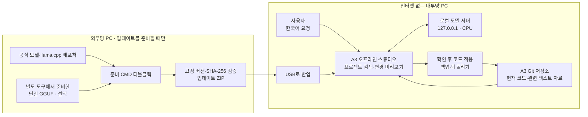

# A3 오프라인 스튜디오

앱 개발 저장소는 `kjuws10-rgb/A3_LD_Process_Local_LLM`입니다. 앱이 분석하는 `A3_LD_Process_SW_IPS`는 별도의 대상 저장소이며, 그 코드는 공개 앱 저장소에 포함하지 않습니다. 오프라인 툴체인 준비 도구는 이웃한 대상 checkout을 찾거나 대상 폴더를 한 번 선택하도록 합니다.

`A3_LD_Process_SW_IPS`의 현재 코드와 승인한 관련 자료를 찾아, 인터넷 없이 한국어로 설명하고 코드 변경을 제안하는 Windows 응용프로그램입니다. 앱과 추론 엔진은 같은 PC에서 실행됩니다. 외부 AI 계정·API 키·클라우드 접속은 필요하지 않습니다.

## 사용자가 하는 일: 처음 3단계

1. **외부망 PC에서 준비:** `tools/A3.OfflineStudio/packaging/Prepare-OfflineBundle.cmd`를 더블클릭합니다. 완료되면 표시되는 ZIP을 USB에 복사합니다. 처음에는 .NET 10 SDK가 있는 외부망 PC에서 실행합니다. 이후 모델 갱신만 할 때는 `Prepare-ModelUpdate.cmd`를 사용하면 앱 빌드가 필요 없습니다.
2. **내부망 PC에서 한 번 연결:** 첫 설치는 ZIP의 `app` 폴더를 원하는 위치에 풀고 `A3.OfflineStudio.exe`를 실행합니다. 화면에서 A3 저장소 폴더와 USB의 업데이트 ZIP을 각각 한 번 선택합니다. 기존 앱이 있으면 업데이트 ZIP만 가져옵니다.
3. **평소에는 요청만 입력:** 예를 들어 “모터 운전 상태가 화면에 표시되는 흐름을 설명해 줘”, “이 예외를 처리하는 수정안을 만들어 줘”라고 입력합니다. 코드 변경은 화면의 차이를 확인하고 적용합니다. 문제가 있으면 되돌리기를 사용합니다.

모델을 처음 읽을 때와 긴 요청을 처리할 때는 시간이 걸립니다. 화면의 진행 상태를 기다려 주세요. 터미널·모델 서버를 따로 실행할 필요는 없습니다. 앱을 종료하면 함께 실행한 모델 서버도 종료됩니다.

## 어디서 무엇이 움직이는가



프로젝트 코드가 외부망의 준비 도구로 전송되는 경로는 없습니다. 준비 도구는 공식 배포처의 모델·실행기·라이선스 파일만 받습니다. 앱을 직접 빌드하면 외부망 PC의 .NET SDK가 앱 빌드에 필요한 NuGet 패키지도 복원합니다.

## 모델과 PC 기준

| 프로필 | 반입 모델 | 모델 파일 크기 | 용도 |
|---|---|---:|---|
| `fast` · 기본 | Qwen2.5-Coder-1.5B-Instruct Q4_K_M | 1,117,320,768바이트 · 약 1.04 GiB | 빠른 시작, 짧은 설명·작은 수정 |
| `quality` · 선택 | Qwen2.5-Coder-7B-Instruct Q4_K_M | 4,683,073,536바이트 · 약 4.36 GiB | 복잡한 코드 초안, 더 높은 메모리·대기 시간 허용 |

공식 Windows CPU 실행기 ZIP은 24,407,745바이트입니다. 앱·캐시·작업 폴더·완성 ZIP이 함께 존재하므로 외부망 PC에는 모델 크기의 약 3배 이상과 앱 빌드 공간이 필요합니다. 내부망 PC도 새 모델과 이전 모델을 보관할 디스크 여유가 필요합니다.

2026-11-03 확인한 개발 PC는 RAM 약 15.91 GiB, Intel i7-7700HQ 4코어/8스레드, NVIDIA 920MX 2 GiB입니다. 기본 CPU 프로필을 적용합니다. CPU 추론 속도와 코드 정확도는 실제 작업에 따라 다르며, GPU가 있어도 이 앱은 현재 CPU 실행기를 사용합니다. 7B가 더 크다고 모든 수정이 정확해지는 것은 아닙니다.

두 기본 모델의 배포 라이선스는 Apache-2.0이고 llama.cpp는 MIT입니다. 준비 ZIP의 `licenses/`와 `THIRD-PARTY-NOTICES.txt`를 보존합니다. 모델 버전·원본 URL·SHA-256은 `manifest.json`에도 기록합니다. 상세 조건은 동봉된 원문을 확인합니다.

## 자료와 코드 작업

- A3 저장소의 Git 추적 텍스트 파일과 사용자가 가져온 승인 자료를 검색합니다. Git 경로와 원격 주소를 확인해 프로젝트를 제한합니다.
- 요청할 때 현재 파일을 다시 읽어 관련 부분을 모델에 제공합니다. 모델을 다시 학습시키지 않아도 최신 코드가 검색에 반영됩니다.
- 답변에 사용한 파일과 줄 위치를 표시합니다. 표시된 자료가 실제 답변의 모든 주장을 보증하지는 않으므로 중요한 수정은 근거와 함께 확인합니다.
- 변경안을 적용하기 전에 차이를 보여주고, 원본이 바뀌었으면 덮어쓰기를 막습니다. 적용 전 파일을 보관하여 되돌릴 수 있습니다.
- 자료는 `.md`, `.txt`, `.csv`, `.json`, `.xml` 등의 지원 텍스트로 가져옵니다. Word `.docx`와 Excel `.xlsx`는 텍스트를 추출하여 가져옵니다. 서식·도표·이미지를 해석하는 기능은 없으며, PDF는 필요한 내용을 텍스트로 내보낸 뒤 가져옵니다.
- Excel 수식은 재계산하지 않고 파일에 저장된 결과를 읽습니다. 저장 결과가 없으면 해당 값이 빠질 수 있으며, 날짜·숫자 표시 형식은 원시 값으로 보일 수 있습니다. 필요한 시트를 확인해 CSV로 내보내면 자료 범위를 명확하게 관리할 수 있습니다.
- 앱의 코드 빌드 검사는 아래 도구 묶음 또는 기존 A3 개발 도구·복원 의존성이 있어야 합니다. 모델 실행에 필요한 .NET 런타임과 A3 프로젝트를 컴파일하는 SDK·MSBuild는 별개입니다.

“프로젝트 자료를 기반으로 답한다”는 말은 검색·파일 접근 범위를 뜻합니다. 사전학습 모델은 일반적인 프로그래밍 지식도 갖고 있으며, 답변이 틀리거나 근거 없는 내용을 생성할 수 있습니다. 인터넷 검색이나 다른 프로젝트 검색은 수행하지 않습니다.

## 외부망 관리자가 사용하는 명령

기본 준비는 CMD 더블클릭으로 충분합니다. PowerShell 5.1에서도 실행할 수 있습니다.

```powershell
# 최초 설치: 앱을 자체 포함 Windows x64 형식으로 빌드하고 모델/실행기를 묶기
.\Prepare-OfflineBundle.ps1

# 이미 publish한 앱으로 패키지 만들기 (.NET SDK 없이 준비 가능)
.\Prepare-OfflineBundle.ps1 -AppDirectory 'D:\A3Published'

# 기존 내부망 앱에 가져올 모델/실행기 업데이트만 만들기
.\Prepare-OfflineBundle.ps1 -ModelRuntimeOnly

# 7B 선택: 다운로드와 저장 공간이 더 필요
.\Prepare-OfflineBundle.ps1 -ModelRuntimeOnly -ModelProfile quality

# 외부망에서 별도로 준비한 커스텀 GGUF를 모델 다운로드 없이 묶기
.\Prepare-OfflineBundle.ps1 -ModelRuntimeOnly -CustomModelPath 'D:\Models\A3.gguf' -CustomModelName 'A3 custom model'

# 커스텀 모델의 라이선스 원문을 함께 반입하려면 선택 인수 추가
.\Prepare-OfflineBundle.ps1 -ModelRuntimeOnly -CustomModelPath 'D:\Models\A3.gguf' -CustomModelLicensePath 'D:\Models\LICENSE.txt'

# 공식 버전 메타데이터만 확인: 대용량 파일은 받지 않음
.\Prepare-OfflineBundle.ps1 -ValidateCatalogOnly

# PowerShell 5.1 패키지 검사: 소량의 라이선스 파일만 내려받는 검증 포함
.\Test-OfflineBundle.ps1 -IncludeNetwork
```

실패하면 같은 CMD나 명령을 다시 실행합니다. `.cache`의 완료 파일은 SHA-256을 다시 확인해 재사용하고, `.partial` 파일은 이어받기를 시도합니다. 서버가 부분 요청을 지원하지 않으면 해당 파일을 처음부터 다시 받습니다. 재시도 후에도 실패하면 공식 원본 URL과 오류를 표시하며, 검증에 실패한 파일은 업데이트로 채택하지 않습니다.

출력 `output/a3-…-fast.zip`, `…-quality.zip` 또는 `…-custom.zip`이 반입할 묶음입니다. `.zip.sha256`은 ZIP 자체의 무결성 확인용입니다. `output/bundle-…/app`은 처음 실행할 앱 파일입니다. `-ModelRuntimeOnly`에는 `app/`이 없습니다. 스크립트는 완료·실패 작업 폴더와 캐시를 자동 삭제하지 않으며, 관리자는 필요에 따라 해당 폴더만 정리할 수 있습니다.

## 외부망에서 만든 커스텀 모델 반입

`Prepare-CustomModelUpdate.cmd`를 더블클릭하면 GGUF 파일을 한 번 선택하는 창이 열립니다. 파일 선택 후 공식 실행기와 함께 `…-custom.zip`을 만듭니다. 준비한 ZIP은 내부망 앱의 같은 **모델 업데이트 가져오기** 버튼으로 반입합니다. 원본 모델을 외부 서비스에 업로드하지 않으며, 모델 파일 다운로드도 수행하지 않습니다. 실행기가 캐시에 없으면 공식 실행기와 그 라이선스만 내려받습니다.

외부망의 별도 도구에서 학습·미세학습했다면 llama.cpp가 실행할 수 있는 완성된 단일 `.gguf` 파일을 준비합니다. LoRA 어댑터만 있는 파일이나 분할 GGUF 조각을 선택하는 방식은 지원하지 않습니다. 이 앱은 학습·어댑터 병합·GGUF 변환을 수행하지 않습니다.

준비 도구는 GGUF 식별자, 파일 크기, 전체 SHA-256을 확인하고 복사 후 다시 검증합니다. GGUF 식별자가 맞아도 해당 모델 구조·채팅 템플릿이 고정 실행기와 호환된다고 보장하지는 않습니다. 실제 로딩·답변 품질은 별도로 확인하며, 내부망에서 시작에 실패하면 기존 활성 모델로 복구를 시도합니다. 커스텀 파일은 현재 반입 제한인 18 GiB 이내여야 합니다.

커스텀 모델의 라이선스·배포 권한·학습 데이터 사용 권한은 외부망 관리자 확인 사항입니다. 기본 Qwen 모델의 Apache-2.0 라이선스가 커스텀 모델에 자동으로 적용되지 않습니다. 선택 인수 `-CustomModelLicensePath`로 UTF-8 또는 일반 텍스트 원문을 지정하면 `licenses/custom-model-LICENSE.txt`로 포함합니다. 기본 파일 선택 흐름에서는 추가 질문하지 않습니다. 조직 배포에 필요한 라이선스가 있으면 명령 인수로 반드시 포함합니다.

커스텀 모델의 출처 기록에는 표시 이름·SHA-256·관리자 제공 모델이라는 구분만 넣습니다. 자동으로 원본 절대경로나 파일 이름을 기록하지 않습니다. 표시 이름에도 프로젝트 기밀이나 경로를 넣지 마세요.

## 인터넷 없이 원본 프로젝트 빌드하기

1. 외부망 PC에서 **`Prepare-OfflineToolchain.cmd`를 더블클릭**합니다. 공식 .NET SDK와 현재 A3 프로젝트의 참조 패키지를 준비합니다. 이 PC에는 원본 저장소와 Git for Windows가 있어야 합니다.
2. 완료된 **`output/toolchain` 폴더 전체를 USB로 복사**하여 내부망의 `A3.OfflineStudio.exe` 옆에 둡니다. 개별 파일을 선택하거나 SDK를 전역 설치할 필요는 없습니다.
3. 내부망 앱에서 **빌드 검사**를 누릅니다. 앱이 옆의 휴대형 SDK와 로컬 패키지 공급 폴더를 사용합니다.

```text
A3_Offline_Studio/
├─ A3.OfflineStudio.exe
└─ toolchain/
   ├─ dotnet.exe              .NET SDK 10.0.400 · Windows x64
   ├─ sdk/, packs/, shared/   SDK에 포함된 빌드 도구와 런타임
   ├─ feed/                  .NET 8 참조 팩·프로젝트 의존성 .nupkg
   ├─ NuGet.Config           외부 소스 제거 · 상대경로 feed만 사용
   ├─ toolchain-manifest.json 각 파일 크기·SHA-256·SDK 원본 SHA-512
   └─ A3-TOOLCHAIN-NOTICES.txt
```

이 도구는 SDK **10.0.400**을 고정 사용하며, 현재 최신 버전을 자동 선택하지 않습니다. 공식 .NET 10 릴리스 메타데이터의 URL·SHA-512와 대조한 뒤 약 286.6 MiB SDK ZIP을 받습니다. 압축 해제·임시 소스·복원 패키지를 위한 추가 디스크 공간이 필요합니다.

외부망 준비는 Git 추적 파일의 **현재 내용**을 짧은 임시 폴더에 복사한 뒤 수행합니다. 원본 저장소에 `obj`나 복원용 절대경로를 쓰지 않습니다. 외부망 복원은 저장소의 패키지 폴더와 공식 NuGet 소스를 사용하며, 원본 코드를 업로드하지 않습니다. 받은 `.nupkg`를 `feed`에 보존한 다음, **별도의 빈 패키지 캐시와 외부 소스 없는 설정**으로 다시 복원하여 필요한 .NET 8 참조 팩과 의존성이 반입되는지 확인합니다.

**도구·패키지 공급과 원본 코드의 컴파일 성공은 구분합니다.** 현재 원본 코드의 컴파일 오류를 이 묶음이 자동 수정하지는 않습니다. 누락된 독점 장비 SDK·드라이버·원본 응용프로그램 실행에 필요한 환경도 별도로 확인합니다. 준비 도구의 성공은 SDK 실행과 로컬 공급 폴더만으로 패키지 복원을 확인했다는 뜻입니다.

관리자가 경로를 지정할 때는 아래 명령을 사용할 수 있습니다.

```powershell
.\Prepare-OfflineToolchain.ps1 -RepositoryPath 'D:\A3_LD_Process_SW_IPS'
# 대용량 다운로드 없이 고정 SDK의 공식 URL·SHA-512만 확인
.\Prepare-OfflineToolchain.ps1 -ValidateCatalogOnly
```

## 반입과 버전 변경 방식

```text
업데이트 ZIP
├─ manifest.json              파일 목록·크기·SHA-256·모델 정보·공식 출처
├─ models/model.gguf          반입할 모델 하나
├─ runtime/llama-server.exe   고정 버전 실행기와 필요한 DLL
├─ licenses/                  원본 라이선스
├─ THIRD-PARTY-NOTICES.txt
└─ app/                       최초 설치용 publish 결과 · 선택
```

내부망 앱은 ZIP 경로·파일 목록·크기·SHA-256을 검증하고 새 버전 폴더에 설치한 뒤 모델을 실행합니다. 설치 후에도 `manifest.json`의 `sources`를 보존하여 공식 원본과 리비전을 추적할 수 있습니다. 이전 모델로 돌아갈 수 있게 이전 버전을 유지합니다. `app/`에 포함된 응용프로그램 자체를 실행 중 자동 교체하는 기능은 제공하지 않습니다. 앱 프로그램 갱신은 앱 종료 후 새 `app/` 파일로 실행합니다.

현재 묶음은 **전자서명되지 않았습니다.** 파일 목록과 SHA-256은 손상·내용 불일치를 확인하지만, 누가 만들었는지 증명하지 않습니다. 조직에서 신뢰하는 외부망 준비 PC에서 생성한 묶음을 반입해야 합니다. 내부망 앱은 절대경로·상위경로 이탈·중복 경로·링크·과도한 압축 해제 크기를 거부합니다.

현재 실행 프로필은 `--offline`, `--host 127.0.0.1`, `--n-gpu-layers 0`, `--parallel 1`, `--ctx-size 4096`을 사용합니다. 모델의 자동 다운로드·터널·내장 셸 도구를 사용하지 않습니다. 네트워크 격리는 실제 내부망 정책과 물리 연결 구성으로 유지합니다. 이 앱이 조직 네트워크 장비를 설치하거나 방화벽 정책을 자동 변경하지는 않습니다.

## 개발 검증

저장소 루트에서 아래 명령으로 앱의 실제 소스에 연결된 통합 검사를 실행할 수 있습니다. 외부 NuGet 패키지와 실제 모델은 사용하지 않습니다. 임시 ZIP·Word·Excel과 같은 PC의 가짜 모델 서버로 검증합니다.

```powershell
dotnet run --project tools/A3.OfflineStudio.IntegrationTests -c Release
```

정상 반입, 파일 변조·경로 이탈·중복·예상 밖 파일·링크·위조된 압축 해제 길이 거부, 실패 시 이전 모델과 설정 유지, 공식 출처 보존, Word·Excel 텍스트 추출과 외부 XML 엔터티 차단을 검사합니다. 실행기 종료·비정상 종료 후 준비 상태 해제·부모 앱 강제 종료 시 Windows Job을 통한 자식 실행기 종료도 검사합니다. 실제 모델의 코드 작성 품질과 장비 제어 동작은 별도의 실제 환경 검증이 필요합니다.

## 현재 범위와 확장 방향

현재 구현은 단일 Windows PC의 전용 코드 도우미입니다. 여러 사람이 공동 사용하는 중앙 GPU 서버, 사용자별 권한·감사 체계, 조직 배포 전자서명, PDF·이미지 해석, 모델 미세학습·재학습 파이프라인은 포함하지 않습니다.

“모델 업데이트”는 외부망에서 검토한 새 모델 파일과 실행기를 다시 묶어 반입하는 방식입니다. 프로젝트 코드 변경은 자료 검색으로 즉시 반영하며, 프로젝트마다 모델을 재학습할 필요는 없습니다. 나중에 더 강한 GPU 서버를 배치할 경우 같은 검색·변경 제안 흐름을 유지하면서 별도의 내부망 서비스·인증 계층을 설계할 수 있습니다.

## 고정 원본과 공식 문서

- [llama.cpp b11960 배포](https://github.com/ggml-org/llama.cpp/releases/tag/b11960) · [해당 버전 서버/API/오프라인 옵션](https://github.com/ggml-org/llama.cpp/blob/b11960/tools/server/README.md)
- [Qwen 1.5B 공식 GGUF · 고정 리비전](https://huggingface.co/Qwen/Qwen2.5-Coder-1.5B-Instruct-GGUF/tree/f86cb2c1fa58255f8052cc32aeede1b7482d4361)
- [Qwen 7B 공식 GGUF · 고정 리비전](https://huggingface.co/Qwen/Qwen2.5-Coder-7B-Instruct-GGUF/tree/13fb94bfda8c8cf22497dc57b78f391a9acb426a)
- [llama.cpp MIT 원문](https://github.com/ggml-org/llama.cpp/blob/b11960/LICENSE) · [Qwen Apache-2.0 원문](https://huggingface.co/Qwen/Qwen2.5-Coder-1.5B-Instruct-GGUF/blob/f86cb2c1fa58255f8052cc32aeede1b7482d4361/LICENSE)
- [.NET 10 공식 릴리스 메타데이터](https://builds.dotnet.microsoft.com/dotnet/release-metadata/10.0/releases.json) · [.NET CLI 환경 설정](https://learn.microsoft.com/en-us/dotnet/core/tools/dotnet-environment-variables) · [NuGet 오프라인 인증서 폐기 확인](https://learn.microsoft.com/en-us/nuget/reference/errors-and-warnings/nu3028)
